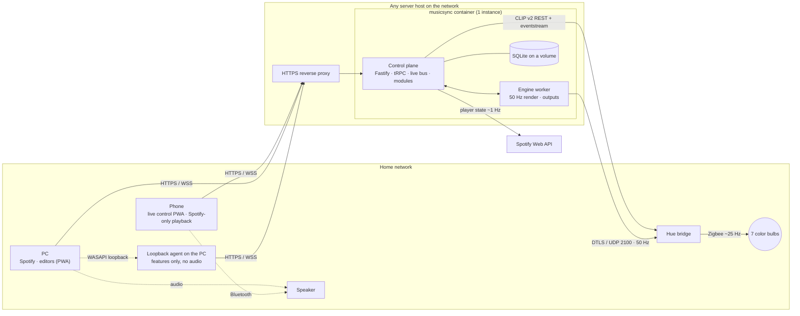
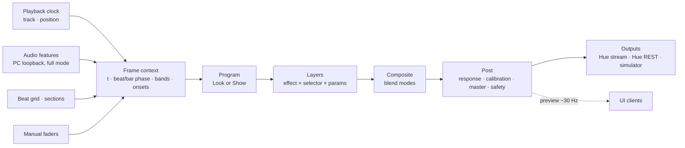
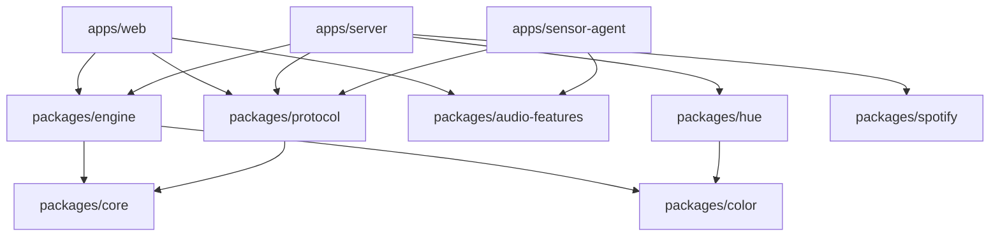

# musicsync — Architecture

> **Status:** Implemented through Phase 5 of the [roadmap](#13-roadmap). Where the build differs from this design, the [decision log](#16-decision-log) and [`docs/decisions/`](decisions/) say so.
> **Scope:** high-level design, technology choices and the build plan.

## 1. Summary

- **Yes, it can be a web app, but a self-hosted one.** A browser can't open the Hue Entertainment stream (DTLS over UDP). It can't call the bridge's local API from an HTTPS page. And it isn't running when your phone is locked. So one always-on **server on the home network** runs the real-time engine, and every phone, laptop and PC is a client (an installable PWA). It ships as one container image that runs on any host on the network (§10).
- **TypeScript end-to-end.** The same render engine runs on the server (driving lights) and in the browser (editor preview), so what you design is exactly what plays.
- **Lights are addressed by place and tag, never by bulb ID.** You place each light on a floor plan and tag it ("ceiling", "tv", "accent"), and effects target tags and positions. Adding a light means placing and tagging it; existing looks and shows pick it up automatically.
- **There are two kinds of program.** **Looks** are reactive presets: layered effects bound to audio and beat signals, usable on any track. **Shows** are hand-authored timelines for one specific track. Per-light responsiveness (attack/release, sensitivity, frequency band, brightness range, latency) is stored as settings, so tuning it needs no code changes.
- **Timing comes from three sources**, because Spotify no longer gives new apps audio analysis:
  - Spotify says *what* is playing and *where* in the track (polled).
  - When Spotify plays on your PC, a **loopback agent** there captures the PC's own audio output and says what it *sounds like* right now. There is no microphone anywhere.
  - A per-track **beat grid**, learned automatically from PC playback or tapped in, says where the beats *will* be. Grids also carry phone playback, which has no live audio (§5.5).

### Assumptions and what they decide

| Assumption | Decides |
|---|---|
| **One Hue bridge with Entertainment support** (Hue Bridge v2 or Bridge Pro), reachable from the server. | Standard link-button pairing. Give the bridge a fixed IP. |
| **Colour-capable Hue lights, up to 10 in the synced set.** | They fit one Entertainment area (Hue's limit is 10), so one stage covers them. More lights, or lights that can't stream, need the REST slow path or a second bridge (later). |
| **No microphone.** Spotify plays either on a Windows PC (desktop app or web player), or on another device such as a phone with a Bluetooth speaker. | Two modes. **Full mode** (Spotify on the PC): a loopback agent captures the PC's audio output before it reaches the speaker, giving full reactivity and automatic beat grids (§5.3–5.4). **Spotify-only mode** (phone): Spotify's playback position plus the grids already learned on the PC, with no live reaction to sound (§5.5). |
| Phones reach the app directly on the LAN. | The host needs an HTTPS name that phones can resolve (§10.1). |

## 2. Platform constraints that shape the design

| Fact (checked Nov 2026) | Consequence |
|---|---|
| The Hue REST API accepts roughly 10 light commands/s per bridge (groups about 1/s). | Anything that changes at music speed must use the **Entertainment stream**. REST is only for slow "ambient" changes (for example on section changes) and for lights that can't join an Entertainment area. |
| The Entertainment stream is DTLS 1.2 with a pre-shared key (`TLS_PSK_WITH_AES_128_GCM_SHA256`) to UDP port 2100. Send at ~50 Hz; the bridge drives Zigbee at ~25 Hz; the stream times out after a few seconds of silence. | Needs a long-running process with a fixed-rate loop, keep-alive and reconnect. A browser can't do this. |
| Only **one Entertainment area streams per bridge** at a time, with **≤10 color-capable lights per area**. A gradient light counts as one light but exposes several channels (Play gradient strip 7, Ambiance gradient 3, Signe 2–3). | A **Stage** (the lights in one sync session) maps to one area per bridge. For more lights at once, use the REST slow path or a second bridge. The app creates and positions the area from your layout, so you never set it up in the Hue app. |
| Spotify `audio-analysis` and `audio-features` are closed to apps without extended quota granted before Nov 2024. | No beats or sections from Spotify. Beat data comes from PC loopback plus learned or tapped beat grids (§5.3–5.4). |
| Spotify Development Mode (Feb 2026): the app owner needs Premium, ≤5 authorized users, reduced endpoint list. The Player endpoints (`GET /me/player`, seek, play/pause, transfer, devices) and `GET /tracks/{id}` (including `external_ids`/ISRC) remain. | Fine for one household. The design depends only on the Player and Track endpoints, not on any of the ones Spotify keeps cutting. |
| Playback position is available only by polling. | A **playback clock** estimates the position between polls, smooths out drift, detects seeks and applies per-device latency offsets (§5.2). |
| Spotify redirect URIs must be HTTPS, except loopback IP literals. `localhost` and the implicit grant have been rejected since 27 Nov 2025. | The app needs a real HTTPS hostname. |
| Browsers can't capture other apps' audio (Chrome's screen share with "share system audio" on Windows is the one clumsy exception), and Node has no system-audio capture of its own. Service workers and PWA install need HTTPS. | Capturing the PC's output needs a small native helper (§5.3). Serve over HTTPS with a certificate the phones trust. |
| Node.js 26 has an experimental `node:dtls`, but only in Node builds compiled with `--experimental-dtls`. | Use `node-dtls-client` (a DTLS client written in TypeScript, supports pre-shared keys, already used by existing Node Hue-streaming projects) behind a transport interface, and swap later. |

## 3. System overview



| Runtime piece | Runs on | Job |
|---|---|---|
| **Server: control plane** (main thread) | server host | HTTP API, live WebSocket bus, auth, storage, Spotify polling, audio features from the loopback agent, the list of known lights, and deciding what to play. |
| **Server: engine worker** (`worker_thread`) | same process | Fixed-rate render loop (50 Hz) feeding the output drivers (Hue stream, Hue REST, simulator). Nothing slow (database, HTTP, memory-heavy work) shares its thread. |
| **Web app** (PWA) | phone / laptop / PC | Live control (phone-first), layout editor, look editor, show editor (desktop-first). Runs its own copy of the engine for previews. |
| **Loopback agent** | your PC | Captures the PC's audio output before it reaches the speaker (WASAPI loopback), turns it into small feature frames (levels, frequency bands, onsets) and streams them. Starts at login. No audio is recorded or sent. |

## 4. Domain model

### 4.1 Glossary

| Term | Meaning |
|---|---|
| **Fixture** | A physical light (bulb, lamp, strip) with a position in your home. |
| **Channel** | An independently colorable part of a fixture (a bulb has 1; a Play gradient strip has 7). Effects render per channel. |
| **Tag / Group** | Tags are labels on fixtures ("ceiling", "tv", "left-wall"). Groups are saved selections (by tag, room or spatial query). |
| **Stage** | The fixtures in one sync session ("Living room", "Main floor"). Resolves to one Entertainment area per bridge plus any REST-path extras. |
| **Effect** | A renderer: (time, signals, channels, parameters) → colors. Pure TypeScript, one file each. |
| **Look** | A reactive preset: a stack of layers (effect × target × parameters × blend mode) whose parameters follow signals. Works on any track. |
| **Show** | A timeline for one track: lanes of clips (effect × target × time range × automation), optionally on top of a Look. |
| **Signal** | A live number effects can follow: `audio.bass`, `audio.onset`, `beat.phase`, `bar.phase`, `section.energy`, `lfo.*`, `manual.master`… |
| **Program** | Whatever is running now (a Look or a Show). The Director module picks it. |
| **Mode** | **Full** when Spotify plays on the PC and the loopback agent hears it, so live audio signals are available. **Spotify-only** when it plays anywhere else, such as your phone; audio signals are then derived from the beat grid. |

### 4.2 Spatial model

```text
Home → Floor (elevation, optional plan image + scale)
     → Room (polygon)
     → Fixture (x, y, z in metres, or a path for strips)
     → Channel (position along the fixture)
```

- Positions are real metres on your floor plan. Each effect sees a channel's position **relative to the current selection**: 0–1 along each axis, distance from an origin, and order along an axis. So a "wave left → right" works on 3 lights or on 30.
- The app writes the Entertainment area's channel positions (Hue's −1…1 space) from the layout, relative to the stage's listening position.
- **Adding a light:**
  1. Hue's event stream reports it, and it appears in an *Unplaced* tray.
  2. You drag it onto the plan, set its height and tag it.
  3. The app adds it to the stage's Entertainment area if it is color-capable and the area has room, otherwise to the REST slow path.

  No show or look needs editing.

### 4.3 Responsiveness is configuration

Every channel has a **response profile**. Defaults are set per fixture and can be overridden per group or look. It covers: brightness range, gamma, attack/release (ms), sensitivity, audio band, latency trim and whether strobing is allowed. Any effect parameter can be **bound to a signal**, with a range, a curve and its own attack/release:

```jsonc
"brightness": { "bind": "audio.bass", "range": [0.15, 1], "curve": "exp", "attackMs": 15, "releaseMs": 220 }
```

That is how "this lamp punches on kicks, that strip breathes with the mids" gets set up without code.

### 4.4 Show document (sketch)

```ts
type Show = {
  schemaVersion: 1;
  id: string;
  name: string;
  track: { source: 'spotify'; id: string; isrc?: string; durationMs: number };
  bed?: LookRef;                      // optional reactive look underneath
  lanes: Array<{
    target: Selector;                 // tags / rooms / fixtures / spatial query, never device IDs
    blend: 'normal' | 'add' | 'max' | 'multiply' | 'screen';
    clips: Array<{
      start: TimePos;
      end: TimePos;                   // ms, or bar/beat when snapped to the grid
      effect: { type: string; version: number; params: Record<string, ParamValue> };
      fadeInMs?: number;
      fadeOutMs?: number;
    }>;
  }>;
};
type TimePos = { ms: number } | { bar: number; beat: number };
type ParamValue = number | string | Color | { keyframes: Keyframe[] } | SignalBinding;
```

- Documents are versioned JSON, validated with Zod, upgraded to the current schema when loaded, and exportable as files (for backups, sharing and git).
- Clips snapped to musical time follow the beat grid if the grid is refined later.
- The ISRC lets a show follow the same recording across different Spotify track IDs.

## 5. Real-time pipeline



### 5.1 Engine loop

- Runs in a worker thread at a fixed 50 Hz (configurable). Each tick renders for a *time*, not a frame count, so scheduling jitter shifts a frame by a few ms but never accumulates.
- The control plane **prepares** each program before handing it over. Selectors become channel index lists, positions are normalized, automation is pre-sampled and buffers are preallocated. Each tick then allocates no memory, and live tweaks are sent as small patches.
- Colors stay in linear floating-point RGB through the layers and compositing. Each output converts per channel to the device's color range. For Hue that is CIE xy + brightness, using gamut A/B/C from the light's API data.
- Program changes (track change, look switch) crossfade, 500 ms by default.
- Statistics (frame time, jitter, dropped frames, stream state) and preview frames (~30 Hz) go back to the control plane for the UI and `/metrics`.

### 5.2 Playback clock

- Polls `GET /me/player` about once a second while playing. It polls faster near the end of a track to catch the change, slower when paused, and waits when Spotify returns `429 Retry-After`.
- Each sample is timed at send time plus half the *smallest* recent round trip, not at the request's midpoint, and samples with slow round trips count less. Phase 0 showed why: on a slow request most of the extra delay comes after Spotify reads the position, so midpoint timing roughly doubled the apparent error. With round-trip-aware timing the reported position was steady to about 30 ms at p95, on a phone and on a PC.
- Position = sample + elapsed time. Small errors are blended out over 1–2 s so nothing visibly jumps; big ones (seek, skip, pause, track change) reset immediately.
- **Latency compensation:** frames render for `position + offset`, where offset = light latency − audio output latency. Without a microphone nothing can *measure* how long the speaker takes, so you set each offset once by ear with a nudge slider, and it's stored per output:
  - **On the PC**, the agent reports the active Windows output device, so switching between the speaker and headphones switches the offset automatically. Loopback hears the audio before the speaker does, so only the speaker's own delay needs offsetting (Bluetooth roughly 150–300 ms, wired far less).
  - **On the phone**, Spotify only sees "the phone", so one stored offset covers your Bluetooth speaker.
- **On the PC, live beats steer the clock.** Once a track has a beat grid, the beats the agent detects are compared with where the grid says they should be, and the playback clock is nudged to match. Shows played on the PC are then as tight as the beat detection, not as loose as the polling.
- People notice lights that *trail* the sound much sooner than lights that *lead* it. ITU-R BT.1359 puts the detection thresholds at roughly 45 ms (audio ahead of the picture) and 125 ms (audio behind it). Calibration therefore errs early.

### 5.3 Audio input: PC loopback

| Source | Role | Notes |
|---|---|---|
| **Loopback agent** on your PC (`apps/sensor-agent`) | **Primary** (full mode) | A tiny Rust helper using `cpal` opens the default output device as an input, which switches WASAPI to loopback, and pipes raw PCM to a Node process. That process runs the shared `audio-features` DSP and streams the results. The signal is clean and digital, with no room noise. Starts at login (Task Scheduler) and runs hidden. |
| None: Spotify-only | Phone playback, or whenever the agent isn't running | See §5.5. |
| Capture only Spotify's process (Windows process-loopback API, Windows 10 build 20348+) | Later refinement | Stops notification sounds and videos from moving the lights. Needs direct WASAPI calls instead of `cpal`. With the web player the process is the whole browser, so the desktop app isolates better. |
| Chrome screen share with "share system audio" | Stopgap | Works in a browser tab without native code, but asks for permission every session. |
| Linux PulseAudio/PipeWire monitor | If music ever plays from a Linux machine | The same helper. |

- **Why a native helper:** Node can't capture system audio by itself. The helper only moves PCM (about 100 lines, no logic), so all DSP stays in TypeScript, where tests can reach it.
- The agent computes features locally: a windowed FFT into log-spaced frequency bands, loudness (RMS), and onset strength (how sharply the spectrum changes). It sends ~60–100 small frames/s over WSS. Audio is analyzed in memory only; nothing is recorded or stored.
- The agent's clock is synced to the server NTP-style (the best of several pings), so every frame carries server time.
- On the server: automatic gain control per band, onset detection, and tempo and beat-phase tracking (autocorrelation plus a phase-locked loop). Features count only while Spotify reports playing on the PC, so other sounds on the PC can't drive the lights while the music is paused.

### 5.4 Track analysis (beat grids)

Each track gets a `TrackAnalysis`: BPM, offset of the first downbeat, meter, an optional tempo map, and sections (start, label, energy). Every field records its source and a confidence. Sources, highest priority first:

1. **Manual:** tap tempo and grid nudging, in the editor or with the tap button on the Live screen.
2. **Learned:** every track played on the PC gets a grid automatically. Detected beats are mapped onto the track position and fitted to a grid, which improves with each play.
3. **Metadata hint:** an optional third-party BPM/key lookup by ISRC or title. It gives the tempo but not where the beats fall, so it still needs a few taps. These services are candidates to evaluate, not a dependency.

Grids are stored in *track time*, with output-device offsets removed. So a grid learned on the PC works unchanged when the same song plays from your phone. With a grid, beat-synced effects stay locked even through quiet passages.

### 5.5 Spotify-only mode (phone playback)

Used whenever Spotify plays on a device other than the PC, or the agent isn't running.

- **Inputs:** the playback clock, the track's beat grid and sections (if it has them), and the album-art palette.
- **Stand-in signals.** With no live audio, the engine derives the `audio.*` signals from the grid:
  - `audio.onset` from beat and bar triggers,
  - `audio.bass` from a decaying pulse on each beat,
  - `audio.level` from section energy when it's known.

  So the same Look runs in both modes and degrades gracefully. Shows run unchanged, because they are keyed to track position.
- **No grid yet** (a song never played on the PC): ambient looks only, such as album-art palette drift and slow breathing. Tapping along to about 8 beats on the Live screen creates a grid on the spot.
- **Timing.** The polled position itself is steady (about 30 ms at p95, §5.2). The weak point is the Bluetooth speaker's delay, which can only be set by ear, so this mode softens attacks slightly to forgive an offset that's a little off. Seeks and track changes show up within about a second, the poll interval.
- **Start and stop.** One tap on the Live screen starts it, because nothing can confirm you're at home. It stops by itself on pause or when playback ends. Full mode starts by itself.

### 5.6 Safety

The last engine stage is a limiter:
- a maximum flash rate (by default ≤3 large flashes per second, following WCAG 2.3.1),
- a maximum brightness,
- an optional night cap.

It is on by default, with per-stage overrides.

## 6. Code structure

### 6.1 Repo layout (pnpm + Turborepo monorepo)

```text
apps/
  server/          entry point that wires everything up: Fastify, modules, engine-worker host, SQLite
  web/             React PWA
  sensor-agent/    PC loopback agent (Node) + native/ capture helper (Rust, cpal)
packages/
  core/            domain types, Zod schemas, document formats + migrations
  engine/          render engine, effect registry, built-in effects, signals, safety limiter
  color/           OKLab/OKLCH, sRGB, CIE xy, Hue gamut mapping, blend modes
  audio-features/  DSP: FFT, bands, onset strength (runs in the agent and in tests)
  protocol/        live-bus and sensor protocols, binary frame codecs
  hue/             Hue CLIP v2 client, eventstream, Entertainment areas + DTLS stream
  spotify/         Spotify Web API client: PKCE, token refresh, player, tracks
docs/              this file, decisions/
```

### 6.2 Dependency rules



- `core`, `color`, `engine`, `audio-features` and `protocol` must run anywhere: no `node:*` imports and no DOM, enforced by lint. They run in the server, in the browser and in workers.
- `hue` and `spotify` are standalone libraries with no knowledge of the app, so they can be tested (and published) on their own.
- Server modules talk through typed service interfaces and an in-process event bus, never by reading each other's tables.

### 6.3 Server modules

| Module | Owns |
|---|---|
| `devices` | Bridges; pairing (link button → app key + clientkey); discovered lights and their capabilities; staying in sync via the bridge's event stream |
| `layout` | Floors, rooms, fixtures, channels, tags, groups, stages; keeps Entertainment areas matching the layout |
| `music` | Linked Spotify accounts (PKCE, token refresh; Dev Mode allows up to 5), polling, playback clock, playback control, track metadata, album-art palettes |
| `sensors` | Loopback agent registration and token, WSS input, clock sync, gain control, beat tracking |
| `analysis` | Track analyses and their sources |
| `library` | Looks, shows, palettes; version history; import/export; which program each track uses |
| `director` | Decides what runs, in priority order: manual override > show for this track > assigned look > stage default. Prepares programs and crossfades. Picks the mode: full when Spotify plays on the PC and the agent hears it, Spotify-only otherwise. Full mode starts automatically; phone playback starts with one tap. Stops on pause or when playback ends, and restores the lights' previous state |
| `engine-host` | Starts and supervises the engine worker; sends it programs and context; relays its statistics |
| `live` | WebSocket hub: state snapshots, preview frames, live control from clients |
| `auth`, `settings`, `system` | Sessions, config, health, `/metrics`, backups |

### 6.4 Web app screens

- **Live** (phone-first): now playing, mode (full or Spotify-only), start/stop, a tap-tempo button, master brightness and intensity, look and palette picker, faders per group, blackout, live floor-plan preview.
- **Layout**: draw floors and rooms, place lights, draw strip paths, tag lights, define stages.
- **Looks**: layer stack, signal bindings, response tuning, all with live preview.
- **Shows** (desktop-first): timeline editor.
- **Library**: looks and shows, track assignments, import/export.
- **Setup**: bridge pairing, Spotify link, loopback agent status, latency offsets per output device, safety settings.

## 7. Extension points

| To add… | You implement | Touches |
|---|---|---|
| A light | nothing; place and tag it | UI only |
| An effect | `defineEffect()` | One file in `packages/engine/effects`; its parameter schema generates the UI controls |
| A light brand (WLED, Nanoleaf, LIFX, Art-Net…) | `OutputDriver` | A new package, registered with the server |
| A music service | `MusicSource` | A new module |
| A beat or metadata source | `AnalysisProvider` | The `analysis` module |
| An audio source (another PC, a Linux box, a mic if you ever want one) | The sensor protocol | A new agent; the server is unchanged |

```ts
// packages/engine: an effect
export default defineEffect({
  id: 'pulse',
  version: 1,
  name: 'Pulse',
  params: z.object({
    color: colorParam(),                                   // OKLCH picker in the UI
    trigger: z.enum(['beat', 'bar', 'onset']).default('beat'),
    decayMs: numberParam({ min: 20, max: 2000, default: 250 }),
  }),
  render(ctx, channels, p, state, out) {
    /* write linear RGB per channel into `out` */
  },
});

// apps/server: an output driver
interface OutputDriver {
  kind: string;                                    // 'hue-entertainment' | 'hue-rest' | 'sim' | …
  discover(): AsyncIterable<DiscoveredLight>;
  capabilities(ch: ChannelRef): ChannelCaps;       // gamut, max update rate, latency
  open(target: OutputTarget): Promise<OutputSession>;
}
interface OutputSession {
  write(frame: Frame): void;
  close(): Promise<void>;
  onHealth(cb: (h: Health) => void): void;
}
```

Effects always produce the same output for the same time and inputs; random effects use a seeded random generator. That is why editor previews match the real lights, and why each effect can be tested against saved reference frames.

## 8. Tech stack

Phase 1 swapped or deferred some of these; see [decision 0001](decisions/0001-phase-1-skeleton.md).

| Area | Choice | Why | Also considered |
|---|---|---|---|
| Language | **TypeScript** everywhere, plus a ~100-line Rust audio-capture helper | One engine for live output and preview; shared schemas across server, browser and agent; one toolchain for everything with logic in it | **Python**: has the best DSP libraries, but the editor preview would need a second engine or server round-trips, and types would cross over via generated code. **Rust/Go**: not needed for speed (50 Hz × ≤30 channels is trivial) and slower to iterate. A Rust engine compiled to WASM is the fallback if speed ever does matter |
| Server runtime | **Node.js 26 LTS** | Mature UDP and crypto, `worker_threads`, and it's what the Hue DTLS library targets | Bun/Deno: compatibility risk for the `dgram` and crypto APIs the DTLS library uses |
| HTTP server | **Fastify 5** | Its plugins are self-contained, so they double as module boundaries; fast; pino logging; WebSocket and static-file plugins | Express (no isolation or schemas), Hono (fine, but less established on Node), NestJS (heavy framework machinery for a one-person app) |
| API | **tRPC 11 + Zod 4** | End-to-end types without code generation. The same Zod schemas validate requests and documents and generate UI forms | REST + OpenAPI generated clients: more ceremony. An OpenAPI surface can be added later for Home Assistant |
| Realtime | **WebSocket (`ws`)** with a typed protocol | Binary frames for 30–50 Hz previews and sensor features | Socket.IO (heavier message format), SSE (server-to-client only) |
| Hue | **Own `packages/hue`** on CLIP v2 + `node-dtls-client` | Needs v2 Entertainment-area management, streaming and the event stream together. Existing Node wrappers are thin or stale: good references, not dependencies | `node:dtls` once standard Node builds include it |
| Storage | **SQLite** (`better-sqlite3`, WAL mode) + **Drizzle ORM** | One file, nothing to operate, ideal for one household; typed schema and migrations | Postgres (a database server to run for no gain), plain JSON files (no queries or migrations) |
| Frontend | **React 19 + Vite**, TanStack Router + Query | Largest ecosystem for canvas and timeline editors; typed routes; tRPC integration | SvelteKit, Vue: lighter, but smaller editor ecosystems |
| UI components | **Tailwind 4 + shadcn/ui** (Radix) | Accessible and touch-friendly; the components live in the repo, so you can restyle them freely | MUI, Mantine |
| Canvas | **Konva** (`react-konva`) | For the floor plan and timeline: drag, zoom, click detection, and cheap 50 fps color updates | SVG (slow at frame rate), PixiJS (overkill), react-three-fiber (later, for a 3D multi-floor view) |
| Client state | **Zustand** (+ `zundo` for undo/redo) | Small, and usable outside React (needed to talk to the preview engine's worker) | Redux Toolkit |
| PWA | **vite-plugin-pwa** | Installable on phones, full-screen, loads offline | — |
| Audio capture + DSP | **Rust `cpal`** helper for WASAPI loopback; a small DSP library of our own in `audio-features` (TypeScript) | Node can't capture system audio. The helper only moves PCM, so all logic stays in TypeScript; no raw audio over the network | C#/NAudio `WasapiLoopbackCapture` (Windows-only, needs the .NET runtime), Node native addons (immature for loopback), Chrome screen-share audio (asks every session); Meyda or essentia.js for features |
| Monorepo | **pnpm + Turborepo** | Workspace packages; builds and tests are cached | Nx (heavier) |
| Quality | **Vitest**, **Playwright**, **ESLint** (typescript-eslint, type-aware) + Prettier | Fast tests. Type-aware lint catches un-awaited promises (`no-floating-promises`), a real bug source in a long-running async server | Jest, Biome |
| Observability | **pino** logs, **prom-client** `/metrics`, in-app diagnostics page | Makes engine jitter and drops, stream state, clock error and Spotify errors visible | — |
| Delivery | **One Docker image** (`node:26-slim`, pinned) | Runs on any container host; the server also serves the built web app | A separate nginx client image (unnecessary: one process serves UI, API and WebSockets) |

## 9. Data and persistence

- One SQLite file on a persistent volume (`/data/musicsync.db`, WAL mode).
  - Relational tables hold devices, sensors, settings and assignments. The layout (floors, rooms, lights, groups, the stage) is one validated document ([decision 0002](decisions/0002-phase-2-layout.md)).
  - JSON document columns (Zod-validated, versioned) hold looks, shows and track analyses, with a version history on every save.
- **Secrets created at runtime** are the Hue app key and clientkey (from pairing) and the Spotify refresh tokens (from login). They are encrypted in SQLite (AES-256-GCM) with a master key from the environment.
- **Secrets known at deploy time** come from the environment (§10.2): the master key, the Spotify client ID and the admin password hash. PKCE means there's no Spotify client secret to store.
- Backups: a nightly `VACUUM INTO` snapshot on the volume, plus "export everything" (layout, looks and shows as JSON) from the UI.
- The browser never sees Hue keys or Spotify refresh tokens. The optional Web Playback SDK in the editor only gets short-lived access tokens.

## 10. Deployment

The app ships as one container image and assumes nothing about where it runs: a container host on the LAN, a Kubernetes cluster or a Raspberry Pi all work. Runbooks for specific sites live outside this repo.

### 10.1 What the host must provide

| Need | Why |
|---|---|
| **Exactly one instance** (on Kubernetes: 1 replica, `Recreate`) | A bridge accepts one Entertainment stream at a time, and SQLite has one writer |
| **Reach to the Hue bridge** on TCP 443 and UDP 2100 | CLIP v2 API and event stream; the DTLS light stream. Give the bridge a fixed IP |
| **Outbound HTTPS** to `api.spotify.com`, `accounts.spotify.com` and the album-art CDN | Playback polling, token refresh, artwork |
| **A persistent volume** at `/data` | `musicsync.db`: layout, looks, shows, encrypted credentials |
| **An HTTPS hostname** that phones on the LAN resolve | PWA install, and Spotify redirect URIs must be HTTPS. The redirect is `https://<host>/api/auth/spotify/callback`; Spotify never calls it, only the browser finishing the login has to reach it |
| **A WebSocket-capable proxy** serving the app at `/` with no path rewrite | The live bus and the loopback agent use WebSockets, and path rewriting plus upgrades is a common cause of hung connections |
| **No CPU throttling** (on Kubernetes: a CPU request but no CPU limit) | Throttling stalls the 50 Hz render loop, which shows up as stutter |
| **Reach from the PC running the loopback agent** | It streams audio features to the server over WSS |

The server can sit on a different subnet from the bridge, as long as routing and firewalls let it open the two bridge ports. Bridge discovery over mDNS only works on the same subnet, so the setup wizard also accepts a bridge IP. Verify the bridge certificate against Philips Hue's `root-bridge` CA, with CN = the bridge ID.

### 10.2 Configuration

| Setting | Contents |
|---|---|
| `MUSICSYNC_MASTER_KEY` | 32 random bytes (hex) that encrypt runtime secrets in the database |
| `SPOTIFY_CLIENT_ID` | From the Spotify developer dashboard (PKCE, so no client secret) |
| `ADMIN_PASSWORD_HASH` | bcrypt hash of the household password |
| `PUBLIC_URL` | The HTTPS URL clients use; it also sets the Spotify redirect URI |

Inject them however the host handles secrets (env file, Kubernetes Secret, a secret store). Hue keys and Spotify tokens are created at runtime by pairing and login, and stored encrypted in the database.

### 10.3 Container

Runs as a non-root user (uid 1000), works with a read-only root filesystem plus a writable `/tmp`, and needs no Linux capabilities. Host networking is only needed for mDNS bridge discovery.

## 11. Security

- The app controls physical devices, so it has auth from day one: one household password and an httpOnly session cookie, plus a token for the loopback agent. OIDC login can come later.
- If it's ever exposed beyond the LAN: an authenticating proxy in front, plus the app's own auth.
- Hue keys and Spotify tokens stay on the server, encrypted at rest.
- The photosensitivity limiter is on by default (§5.6).

## 12. Testing

| Area | Approach |
|---|---|
| Engine | Unit tests, plus reference-frame tests: render at time t and compare against saved colors. Deterministic by design. |
| Color | Property tests for round-trip conversions and gamut mapping. |
| Hue | Byte-level tests of the stream encoder; tests of the start / keep-alive / reconnect logic; a manual smoke-test script against the real bridge. |
| Spotify | Recorded API responses; playback-clock simulations (noisy polls, seeks, pauses) checked against error limits. |
| Audio | DSP tests on synthetic signals (click tracks, sine sweeps), so no recordings are needed. |
| Web | Vitest + Testing Library; Playwright for core flows. |
| CI | Typecheck, lint and tests on every push; image build on release. |

## 13. Roadmap

Every phase ends in something deployable.

| Phase | Delivers | Done when |
|---|---|---|
| **0. Spikes** (done 2026-11-22, all go) | Three spikes, detailed below: Hue streaming, the Spotify clock and PC loopback | Go/no-go on `node-dtls-client` and the loopback helper; measured clock error on the PC and the phone, capture latency and onset-detection quality |
| **1. Walking skeleton** (done 2026-11-24, [decision 0001](decisions/0001-phase-1-skeleton.md)) | Monorepo, CI, container image and a first deployment. Bridge pairing wizard, Spotify link, engine worker with Hue and simulator outputs, one built-in reactive look, Now Playing and master controls. The loopback agent on your PC | Spotify plays on the PC → the lights react through the deployed app, controlled from the phone |
| **2. Layout** (done 2026-11-25, [decision 0002](decisions/0002-phase-2-layout.md)) | Floor/room editor, placing the lights, tags, groups, a stage, an app-managed Entertainment area, the Unplaced tray, spatial effects | A new bulb joins sync by placing and tagging it |
| **3. Looks** (done 2026-11-25, [decision 0003](decisions/0003-phase-3-looks.md)) | Effect library, layer stack, signal bindings, per-light response profiles, palettes (album art and OKLCH), look editor with preview, track/playlist → look rules, automatic start/stop for PC playback | One lamp's response can be tuned without touching the others. Playing Spotify on the PC starts the lights by themselves |
| **4. Beat grids + Spotify-only mode** (done 2026-11-25, [decision 0004](decisions/0004-phase-4-beats.md)) | Beat tracker, grids learned automatically from PC playback, tap tempo (editor and Live screen), live beats steering the clock on the PC. Spotify-only mode for phone playback: stand-in signals, softened timing, one-tap start, the phone's speaker offset | Beat effects stay locked through quiet passages. A song played from the phone keeps its beat-synced look if it has been played on the PC before |
| **5. Show editor** (done 2026-11-25, [decision 0005](decisions/0005-phase-5-shows.md)) | Timeline lanes, clips and automation; beat snapping; transport driven by Spotify (scrubbing seeks the song); floor-plan preview; audition on the real lights; import/export | A song plays its authored show automatically |
| **Later** | Remote access, capturing only Spotify's process, Linux capture, MIDI/Stream Deck control, Home Assistant hooks, Claude-drafted shows from a track's sections, other brands (WLED, Nanoleaf, LIFX). Past 10 lights, or with bulbs that aren't color-capable: the REST slow path or a second bridge | — |

**Phase 0 detail.** Three throwaway spikes on a PC on the bridge's network, since removed from the repo; their results are folded into this document:

1. **Hue:** pair (link button), create an Entertainment area via CLIP v2 and stream a 50 Hz test pattern with `node-dtls-client`. Result: a 13 ms handshake, 50 Hz with no errors.
2. **Spotify:** PKCE login with a loopback redirect, and the playback clock's error with Spotify playing on a PC and on a phone. Result: steady to about 30 ms at p95 with round-trip-aware timing (§5.2).
3. **PC audio:** a Rust `cpal` loopback helper piping PCM into a Node DSP prototype. Result: works; onsets are detected about 20 ms after capture.

## 14. Risks

| Risk | Mitigation |
|---|---|
| `node-dtls-client` breaks with a future bridge firmware | Phase 0 confirmed it works on a Hue Bridge Pro (13 ms handshake, 50 Hz, 0 errors). The transport sits behind an interface. Fallbacks: `node:dtls` once standard builds include it, or a small sidecar built on OpenSSL or Go `pion/dtls` (check that it supports the PSK-GCM suite) |
| The Spotify position or device latency feels off | Round-trip-aware clock (Phase 0: steady to about 30 ms at p95), per-output offsets, live beats steering the clock on the PC; err early |
| Spotify removes more endpoints | Only the Player and Track endpoints are used, behind the `MusicSource` interface. Analysis never depends on Spotify |
| Without a microphone, speaker delay can't be measured | Set once by ear per output device. On the PC the agent reports the output device, so the right offset is picked automatically |
| Other sounds on the PC (notifications, videos) move the lights | Features count only while Spotify reports playing on the PC; later, capture only Spotify's process |
| Phone playback looks looser than PC playback | Softened attack and release, stand-in signals from learned grids, ambient looks when there's no grid |
| The native helper breaks after a Windows or driver update | It's ~100 lines with no logic; Chrome's system-audio capture as a stopgap |
| More than 10 lights later, or bulbs that aren't color-capable | One streaming area holds ≤10 lights per bridge: add the REST slow path or a second bridge |
| The server is down, so no light sync | Lights keep working normally via the Hue app and switches |
| Garbage-collection or event-loop pauses | The engine has its own worker; ticks allocate no memory; no CPU limit |

## 15. Open questions

None at the moment. Questions answered while building are folded into the sections above and the [decision records](decisions/).

## 16. Decision log

| # | Decision | Status |
|---|---|---|
| D1 | Self-hosted server with PWA clients (not a desktop app, not cloud-hosted) | Accepted |
| D2 | TypeScript monorepo; the engine runs on both server and browser | Accepted |
| D3 | Entertainment stream for music-speed output; REST only for slow layers | Accepted |
| D4 | Lights addressed by layout and tags; the app manages Entertainment areas | Accepted |
| D5 | Beat data from PC loopback and beat grids, never from Spotify | Accepted |
| D6 | SQLite with versioned JSON documents | Accepted |
| D7 | One container image, deployment-agnostic (one instance, no CPU throttling) | Accepted |
| D8 | No microphone. PC loopback is the only live audio source; phone playback runs in Spotify-only mode on learned grids | Accepted |
| D9 | Phones reach the app on the LAN, not through a public tunnel | Accepted |
| D10 | npm workspaces, with Node 26 running the TypeScript directly; only the web app is built ([0001](decisions/0001-phase-1-skeleton.md)) | Accepted |
| D11 | `node:sqlite` key-value store with encrypted secrets until relational data arrives ([0001](decisions/0001-phase-1-skeleton.md)) | Accepted |
| D12 | Plain routes plus the WebSocket live bus until the editors need tRPC ([0001](decisions/0001-phase-1-skeleton.md)) | Accepted |
| D13 | The layout is one versioned document; one stage; the app rewrites its Entertainment area from the plan ([0002](decisions/0002-phase-2-layout.md)) | Accepted |
| D14 | Looks: OKLCH palettes, sRGB-encoded compositing with an RGB stream, preview on the real lights, one library document ([0003](decisions/0003-phase-3-looks.md)) | Accepted |
| D15 | Beat grids: one tempo and beat position per track, learned on the PC or tapped; predicted beats; per-device light delays that can go negative for grid beats ([0004](decisions/0004-phase-4-beats.md)) | Accepted |
| D16 | Shows: one document per track, clips with times that follow the beat grid when snapped, keyframe automation, Spotify as the transport ([0005](decisions/0005-phase-5-shows.md)) | Accepted |

New or changed decisions each get a short write-up in `docs/decisions/`.

## References

- Spotify: [Update on developer access (Feb 2026)](https://developer.spotify.com/blog/2026-02-06-update-on-developer-access-and-platform-security) · [Feb 2026 migration guide](https://developer.spotify.com/documentation/web-api/tutorials/february-2026-migration-guide) · [Feb 2026 changelog](https://developer.spotify.com/documentation/web-api/references/changes/february-2026) · [Mar 2026 changelog](https://developer.spotify.com/documentation/web-api/references/changes/march-2026) · [Redirect URIs](https://developer.spotify.com/documentation/web-api/concepts/redirect_uri) · [OAuth migration, 27 Nov 2025](https://developer.spotify.com/blog/2025-10-14-reminder-oauth-migration-27-nov-2025) · [audio-features 403 thread](https://community.spotify.com/t5/Spotify-for-Developers/Web-API-Get-Track-s-Audio-Features-403-error/td-p/6654507)
- Hue: [Entertainment FAQ](https://www.philips-hue.com/en-us/support/topic/entertainment/100085) · [Gradient channel counts (Hueblog)](https://hueblog.com/?p=15395) · [music-assistant/hue-entertainment](https://github.com/music-assistant/hue-entertainment) · [hue-sync (Node reference)](https://github.com/jdmg94/hue-sync)
- DTLS: [node-dtls-client](https://www.npmjs.com/package/node-dtls-client) · [Node.js `node:dtls` (experimental)](https://nodejs.org/api/dtls.html)
- Audio capture: [cpal](https://github.com/RustAudio/cpal) · [Windows process loopback (`AUDIOCLIENT_ACTIVATION_TYPE`)](https://learn.microsoft.com/en-us/windows/win32/api/audioclientactivationparams/ne-audioclientactivationparams-audioclient_activation_type)
